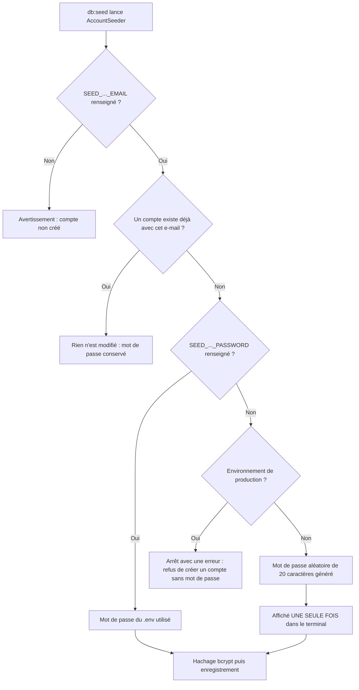

# Comptes d'administration et mots de passe

Ce document explique comment WARISS.DEV crée les comptes d'administration et protège leurs mots de passe : ce qui se passe, dans quel ordre, et pourquoi chaque choix a été fait.

Code concerné :

| Fichier | Rôle |
| --- | --- |
| `backend/config/wariss.php` | Lit les comptes à créer depuis le `.env` |
| `backend/database/seeders/AccountSeeder.php` | Crée les comptes `admin` et `viewer` |
| `backend/app/Console/Commands/SetUserPassword.php` | Commande `app:set-password` |
| `backend/app/Providers/AppServiceProvider.php` | Politique de mot de passe (`Password::defaults()`) |
| `backend/app/Models/User.php` | Hachage automatique du mot de passe, e-mail en minuscules |

---

## 1. Les principes

1. **Aucun mot de passe en clair, nulle part.** Ni dans le code, ni dans Git, ni dans la base de données, ni dans les journaux.
2. **Aucune donnée personnelle dans les fichiers versionnés.** Les e-mails des comptes vivent uniquement dans `backend/.env`, que Git ignore. Le dépôt peut devenir public sans rien exposer.
3. **Un mot de passe n'est connu que de son propriétaire.** Personne ne peut le relire après coup, ni toi, ni le serveur, ni un développeur : la base ne contient qu'une empreinte irréversible.

---

## 2. Comment un mot de passe est stocké : le hachage

Quand on enregistre un mot de passe, Laravel ne le stocke pas tel quel. Il calcule une **empreinte** (un « hash ») avec l'algorithme **bcrypt** :

```text
Mot de passe saisi :  Wariss-Dev-2026!
Stocké en base :      $2y$12$Qx8m3...k2Lz   (60 caractères, toujours différents)
```

- L'empreinte est **irréversible** : impossible de retrouver le mot de passe à partir d'elle.
- Elle contient un **sel aléatoire** : deux comptes avec le même mot de passe ont deux empreintes différentes.
- Elle est **volontairement lente** à calculer (`BCRYPT_ROUNDS=12` : 2¹² tours). Une connexion n'en souffre pas, mais un pirate qui volerait la base mettrait des années à tester des milliards de mots de passe.

Pour vérifier une connexion, Laravel recalcule l'empreinte du mot de passe saisi et la compare à celle stockée (`Hash::check()`). Il ne « déchiffre » jamais rien.

Dans le modèle `User`, le cast `'password' => 'hashed'` applique le hachage automatiquement à chaque enregistrement : il est impossible d'oublier de hacher.

**Conséquence importante : un mot de passe perdu ne se retrouve pas. On en définit un nouveau** (section 5).

---

## 3. La création des comptes : `php artisan db:seed`

### 3.1 Ce que tu configures dans `backend/.env`

```env
SEED_ADMIN_NAME="Wariss BADA"
SEED_ADMIN_EMAIL=ton-adresse-admin
SEED_ADMIN_PASSWORD=
SEED_VIEWER_NAME="Lecteur"
SEED_VIEWER_EMAIL=ton-adresse-lecteur
SEED_VIEWER_PASSWORD=
```

`.env.example` (versionné) contient les mêmes lignes **vides** : il sert de modèle sans rien révéler.

### 3.2 Le déroulement, compte par compte



### 3.3 Pourquoi « affiché une seule fois » ?

Le mot de passe généré n'existe en clair qu'**en mémoire, pendant l'exécution de la commande**. Il est :

1. généré par `Str::password(20)`, qui s'appuie sur le générateur aléatoire cryptographique de PHP (`random_int`) ;
2. affiché dans ton terminal ;
3. haché puis enregistré.

Quand la commande se termine, la version en clair disparaît. Elle n'est écrite dans aucun fichier ni aucun journal. **Si tu ne la notes pas à ce moment-là, personne ne pourra te la redonner** : il faudra en définir une nouvelle (section 5). C'est voulu : un secret qui peut être réaffiché peut aussi être volé.

### 3.4 Pourquoi le seeder ne modifie jamais un compte existant ?

Le seeder est **idempotent** : on peut le relancer sans risque, par exemple après l'ajout de nouvelles données de départ. S'il réécrivait les comptes existants, chaque relance écraserait ton vrai mot de passe par celui du `.env`, ou par un mot de passe vide.

### 3.5 Pourquoi refuser en production ?

En local, générer un mot de passe et l'afficher est pratique. En production, le terminal du serveur peut être journalisé, partagé ou automatisé (déploiement). Le seeder exige donc un mot de passe explicite, et s'arrête sinon.

---

## 4. Définir ou changer un mot de passe : `app:set-password`

C'est **la méthode recommandée**, en local comme en production.

```bash
cd backend
php artisan app:set-password ton-adresse@exemple.com
```

```text
 Nouveau mot de passe:
 >                          ← rien ne s'affiche pendant la frappe
 Confirmez le mot de passe:
 >
 Mot de passe mis à jour pour ton-adresse@exemple.com. Les sessions ouvertes de ce compte ont été fermées.
```

### 4.1 Ce que fait la commande, dans l'ordre

1. **Retrouve le compte** par son e-mail, sans tenir compte des majuscules. Si aucun compte ne correspond, elle s'arrête **avant** de demander le mot de passe.
2. **Demande le mot de passe deux fois, en saisie masquée.** Il n'apparaît ni à l'écran ni dans l'historique du terminal (contrairement à un argument tapé dans la commande).
3. **Valide** que les deux saisies sont identiques et que le mot de passe respecte la politique (section 6). En cas d'échec, **l'ancien mot de passe est conservé**.
4. **Hache et enregistre** le nouveau mot de passe.
5. **Renouvelle le jeton « se souvenir de moi »** : les connexions mémorisées sur d'autres appareils deviennent invalides.
6. **Ferme toutes les sessions ouvertes** du compte (suppression dans la table `sessions`).

Les étapes 5 et 6 sont essentielles si un mot de passe a fuité : quelqu'un de déjà connecté avec l'ancien mot de passe est immédiatement déconnecté.

### 4.2 Pourquoi pas le mot de passe dans le `.env` ?

| Mot de passe dans `.env` | `app:set-password` |
| --- | --- |
| Reste écrit en clair dans un fichier | N'est écrit nulle part |
| Lisible par tout programme ou personne qui accède au dossier | Seul le propriétaire le connaît |
| Peut être copié par erreur (sauvegarde, capture d'écran, partage du dossier) | Rien à copier |
| Ne sert qu'à la création : ne change pas un compte existant | Fonctionne à tout moment |

Si tu as quand même renseigné `SEED_..._PASSWORD` pour créer un compte, **vide la ligne ensuite** : le compte est créé, la ligne ne sert plus à rien.

---

## 5. Mot de passe oublié

En local ou sur le serveur, avec un accès au terminal :

```bash
php artisan app:set-password ton-adresse@exemple.com
```

Une réinitialisation par e-mail depuis l'interface d'administration sera ajoutée avec le module d'authentification (table `password_reset_tokens`, déjà présente).

---

## 6. La politique de mot de passe

Définie une seule fois dans `AppServiceProvider::configurePasswordPolicy()` et utilisée partout via `Password::defaults()` : commande, futur formulaire de changement de mot de passe, réinitialisation.

| Règle | Pourquoi |
| --- | --- |
| 12 caractères minimum | La longueur est le facteur qui rend un mot de passe le plus difficile à deviner |
| Lettres majuscules et minuscules | Augmente le nombre de combinaisons possibles |
| Au moins un chiffre | Idem |
| Au moins un symbole (`!`, `-`, `#`…) | Idem |
| **Production uniquement** : absent des fuites connues | Refuse un mot de passe déjà publié dans une fuite de données, même s'il respecte les autres règles |

**Comment fonctionne la vérification des fuites sans envoyer ton mot de passe ?** Laravel calcule l'empreinte SHA-1 du mot de passe et n'envoie que ses **5 premiers caractères** au service *Have I Been Pwned*. Celui-ci renvoie toutes les empreintes connues qui commencent par ces 5 caractères (plusieurs centaines), et la comparaison se fait sur le serveur WARISS.DEV. Le service ne voit jamais ni le mot de passe ni son empreinte complète : c'est le principe du **k-anonymat**.

Exemple de mot de passe valide : `Wariss-Dev-2026!`. Mieux encore : une phrase de passe générée par un gestionnaire de mots de passe.

---

## 7. Les rôles

| Rôle | Droits |
| --- | --- |
| `admin` | Tous les droits |
| `viewer` | Lecture seule, sans accès aux données sensibles (messages, abonnés, journal d'activité, comptes, réglages) |

- Le rôle est protégé à trois niveaux. **Base de données** : une contrainte `CHECK` refuse toute autre valeur. **Modèle** : le rôle n'est pas modifiable par un formulaire, ce qui empêche un utilisateur malveillant d'envoyer `role=admin`. **Code** : le seeder l'attribue explicitement.
- Les e-mails sont enregistrés en minuscules, et un index unique sur `lower(email)` empêche deux comptes `Admin@…` et `admin@…`.

---

## 8. Ce qu'il ne faut jamais faire

- ❌ Écrire un mot de passe ou une adresse personnelle dans un fichier versionné (`config/`, `.env.example`, code, tests, documentation).
- ❌ Passer un mot de passe en argument de commande (`--password=...`) : il resterait dans l'historique du terminal.
- ❌ Partager le fichier `.env` (capture d'écran, messagerie, dépôt).
- ❌ Réutiliser le mot de passe d'un autre site.
- ❌ Créer un compte en production sans mot de passe explicite : le seeder le refuse.

---

## 9. Retour d'expérience : le bug du mot de passe vide (21/11/2026)

**Ce qui s'est passé.** Au premier `db:seed`, les deux comptes ont été créés **avec un mot de passe vide**.

**Pourquoi.** Dans `.env`, la ligne `SEED_ADMIN_PASSWORD=` ne signifie pas « pas de valeur » mais « valeur = chaîne vide ». Le seeder utilisait `$password ?? générer()`. L'opérateur `??` ne remplace que `null`, pas une chaîne vide : la chaîne vide a donc été hachée et enregistrée.

**Correction.** Le seeder utilise maintenant `filled($password)`, qui considère `null`, `""` et `"   "` comme absents. Les tests couvrent désormais les deux cas (variable absente et variable vide), en local comme en production.

**Impact.** Aucun : l'API n'avait encore aucune route de connexion. Les deux comptes ont reçu un vrai mot de passe avec `app:set-password`.

**Leçon.** Une valeur venant du `.env` peut toujours être une chaîne vide. Il faut la tester avec `filled()` ou `blank()`, jamais seulement avec `??` ou `isset()`.

---

## 10. Aide-mémoire

| Je veux… | Commande |
| --- | --- |
| Créer les comptes (première installation) | `php artisan db:seed` |
| Définir ou changer un mot de passe | `php artisan app:set-password {email}` |
| J'ai oublié mon mot de passe | `php artisan app:set-password {email}` |
| Vérifier les comptes existants (sans mot de passe) | `php artisan tinker --execute 'App\Models\User::all(["email", "role", "is_active"])->each(fn ($u) => print($u->email." ".$u->role->value.PHP_EOL));'` |
